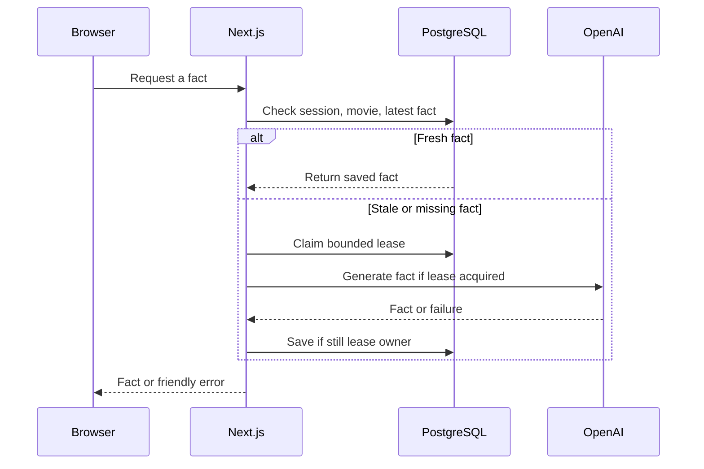

# System design notes

The exercise is intentionally small. The design below addresses correctness and common failure modes without introducing additional services.

## Request flow

## Identity, isolation, and input

- The browser never chooses the effective user ID. Auth.js validates the database session; the application derives the ID from that session and queries the associated movie.
- The fact query always contains both `userId` and `movie`. The onboarding action sets only the session user's currently empty movie field; the dashboard edit action updates only that authenticated user. Server validation trims titles and checks length and control characters.
- PostgreSQL foreign keys cascade on user deletion. The user/movie/time index supports the latest-fact lookup; generated facts remain separate records so a stale fallback exists.
- Same-origin checks protect the fact-generation POST from cross-site form requests. Auth.js manages OAuth state and session cookies; Next.js handles server-action request checks. All fact responses are private and non-cacheable by shared HTTP caches.
- Secrets live in server environment variables. In production, use TLS, least-privilege database credentials, encrypted storage/backups, and secret rotation. The Auth.js database adapter stores account tokens; protect these as sensitive data.

## Correctness under concurrent requests

1. Read the most recent fact for the authenticated user and current movie. Compare its creation time with PostgreSQL's observed time. Freshness is `0 <= age < 60 seconds`.
2. On a miss, atomically update the user row if there is no lease or its lease has expired. This is one conditional SQL statement, so only one process wins for that user at a time.
3. Re-read the cache after winning. A request could have read stale data just before a previous owner saved a fresh fact.
4. Call OpenAI outside a transaction with an 8-second timeout and no automatic retry. The lease lasts 30 seconds to cover normal request and database overhead.
5. In a short transaction, clear the lease only if its random token and expiry still match and the favorite movie remains unchanged, then insert the fact. If the predicate fails, the old worker is fenced off and cannot publish.
6. Other requests poll for a fresh fact for at most about 10 seconds. If generation fails, the owner releases the lease and callers receive the last stored fact or a friendly error.

The design coordinates separate app instances sharing PostgreSQL and has no long-running transaction around an external network call. A lease bounds crash recovery but is not a proof of exactly-once external execution: a timed-out provider request could continue remotely after the lease expires. The token prevents an expired worker from committing stale output. Database unavailability means neither cache nor lock is available; the API returns a generic error rather than fabricating data.

## Important limits and choices

| Concern | Current design | Production direction |
| --- | --- | --- |
| Burst traffic | One generator per user while the lease is valid; waiters poll | Rate limits, quotas, backoff, queue or notifications, load testing |
| Database connections | A Prisma client is reused per warm process; transactions are short | Set connection limits, use a compatible pooler, measure saturation |
| Cache | PostgreSQL stores the last fact and full history | Set retention policy and consider Redis only if measured load warrants it |
| AI reliability | Timeout, no automatic retries, stale fallback | Provider health metrics, bounded retry budget, circuit breaking if needed |
| Fact accuracy | Prompt asks the model to express uncertainty | Ground facts in a trusted source and show attribution |
| Observability | Generic server-side error logs | Structured redacted logs, request IDs, latency/cache-hit/error metrics and alerts |
| Privacy | Authorization and no-store responses | Data deletion/export, retention policy, access audits, backup and key controls |
| Availability | One database is the coordination point | Backups, restore tests, HA topology, disaster recovery |
| Fairness and cost | Successful generations are naturally limited by the cache | Enforce account-level and global rate/spend limits, including repeated failures |

Do not claim these production improvements are already implemented.
